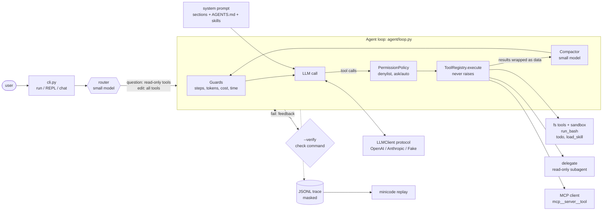

# minicode

**A Claude Code–style coding agent built from scratch in Python. It has no agent framework: just an
LLM client, a tool registry and a ~250-line agent loop you can read in one sitting.**

Give it a task in plain English. It explores the repo, runs the tests, edits code and verifies the
fix. It asks before anything risky, and every step is traced and covered by an eval suite.


> The GIF is recorded with [vhs](https://github.com/charmbracelet/vhs) from [`docs/demo.tape`](docs/demo.tape)
> (`vhs docs/demo.tape`). The demo needs a configured `.env`.

Abridged from a real run (`gpt-6.1-sol`, 2026-10-17):

```text
$ uv run minicode run "Fix the failing tests" --cwd examples/buggy_calculator --verify "pytest -q"
[Route: edit (Fixing failing tests requires changing the project.)]
> run_bash(command="pytest -q")              3 failed, 6 passed
> read_file(path="calculator/ops.py")        ┐
> read_file(path="calculator/stats.py")      ├ run in parallel
> read_file(path="tests/test_ops.py")        ┘
> edit_file(path="calculator/ops.py", old_string="    return a - b", new_string="    return a + b")
> edit_file(path="calculator/ops.py", old_string="    return a // b", new_string="    return a / b")
> edit_file(path="calculator/stats.py", ...)  # average the two middle values
> run_bash(command="pytest -q")              9 passed
[verify passed] pytest -q
verified after 1 check(s) | completed | 12 steps | $0.09
```

## Features

- **Hand-written agent loop** ([`agent/loop.py`](src/minicode/agent/loop.py)) with stopping conditions:
  step limit, token and cost budgets, wall time, and a graceful Ctrl+C that keeps the history valid.
- **Provider-neutral**: OpenAI (Responses API) and Anthropic (Messages API) adapters, with streaming,
  behind one `LLMClient` protocol. Switching provider is one env var.
- **Tools**: `read_file`, `list_dir`, `glob`, `grep`, `write_file`, `edit_file` (exact unique
  replace), and `run_bash` (timeout, output truncation, secrets scrubbed from its environment).
  Every error comes back to the model as a message that tells it how to fix the call.
- **Safety in layers**:
  - a workspace sandbox, enforced at the point of use;
  - permission modes (`ask` / `accept-edits` / `auto`);
  - a command denylist that applies in every mode;
  - tool output wrapped as untrusted data.

  A prompt-injection test shows that the guards hold even when the model is fooled.
- **MCP**, both ways: `minicode mcp-serve` exposes the file tools over stdio, and servers listed in
  `.minicode/mcp.json` are loaded as `mcp__<server>__<tool>`.
- **Context engineering**:
  - a system prompt assembled from sections;
  - `AGENTS.md` as project memory;
  - skills with progressive disclosure (`load_skill`);
  - two-stage context compaction that uses the small model.
- **Workflow patterns**:
  - chaining: `commit-msg`;
  - routing: a small model classifies each task, and questions get read-only tools;
  - parallel read tools;
  - orchestrator-workers: `delegate` to subagents;
  - evaluator-optimizer: `--verify`.
- **Observability and evals**:
  - masked JSONL traces with `minicode replay`;
  - 9 eval tasks with objective checks (bug fixes, a feature, a cross-file rename, codebase questions,
    a skill, and two injection traps) and a results comparison.
- **Tested offline**: 280+ tests run against a scripted `FakeLLMClient`, with about 95% coverage.
  Contract tests per milestone (`pytest -m m3`) let you rebuild the project step by step.

## Quick start

Requires Python 3.12+ and [uv](https://docs.astral.sh/uv/).

```bash
git clone <this repo> && cd minicode
uv sync
cp .env.example .env            # set MINICODE_PROVIDER, MINICODE_MODEL(, MINICODE_SMALL_MODEL) and a key

# One-shot task. Asks before edits and commands; --mode accept-edits|auto to relax.
uv run minicode run "Fix the failing tests" --cwd examples/buggy_calculator --verify "pytest -q"
git checkout -- examples/buggy_calculator    # reset the demo afterwards

uv run minicode --cwd ./my-project           # interactive agent (REPL)
uv run minicode chat                         # plain multi-turn chat, no tools
uv run minicode commit-msg                   # diff -> summary -> commit message
uv run minicode mcp-serve --cwd .            # expose read-only file tools over MCP (stdio)
uv run minicode replay                       # pretty-print the latest session trace
uv run python evals/run_evals.py --model gpt-6.1-sol   # run the eval suite

uv run pytest                                # offline test suite (no API calls)
```

Per-project context: `AGENTS.md` at the workspace root is loaded into every request. Skills in
`.minicode/skills/<name>/SKILL.md` are listed by description and loaded on demand. MCP servers go in
`.minicode/mcp.json`. See `examples/buggy_calculator/` for one of each.

## Architecture



More detail: [docs/architecture.md](docs/architecture.md).

## Design decisions and trade-offs

| Decision | Why | Cost |
|---|---|---|
| No agent framework | The loop, history and guards are the point of the project; every step is visible and testable | More code to write and maintain |
| Neutral internal types plus thin adapters | Agent, tools and tests never touch SDK objects; providers can be swapped | Adapters must track two fast-moving SDKs |
| `ToolRegistry.execute` never raises | Errors become guidance the model can act on ("old_string appears 2 times…") | Handlers must raise *helpful* `ToolError`s |
| Exact-string `edit_file` with a unique `old_string` | Diff and line-number edits are error-prone for LLMs; rewriting whole files wastes tokens | The model must copy text exactly (CRLF handled) |
| Sandbox inside each fs tool, permissions in the loop, denylist in every mode | Defense in depth: a fooled model still meets the guards | A denylist is never complete, so `ask` is the default |
| Stateless calls (`store=False`), full history resent | Honest mental model; works the same on both providers | Cost grows with history, hence compaction |
| Small model for routing, summaries and commit messages | Cheap side tasks are about 20× cheaper | All tokens are priced at the main rate in budgets (slight overestimate) |
| Sync agent with a thread bridge for async MCP | The loop stays readable for learners | One event-loop thread per MCP server |
| Command as the evaluator in `--verify` | Exit codes are objective and free | Only works where a check command exists |
| Evals judge behaviour, not form | The original tests must still pass on the agent's code; adding tests is fine | The checks need tests of their own (one was too strict at first; see M7) |

## Eval results

9 tasks, `auto` mode, a fresh temp copy each, $1 budget per task (2026-10-17, raw JSON and traces in
[`evals/results/`](evals/results/)):

| Config | Pass | Avg steps | Tokens in / out | Cost | Time |
|---|---|---|---|---|---|
| `gpt-6.1-sol` (small: `gpt-6-luna`) | **9/9** | 6.0 | 109,785 / 3,618 | $0.256 | 160 s |
| `gpt-6-luna` as the main model | **9/9** | 7.7 | 165,071 / 5,733 | $0.019 | 145 s |

The small model needs about 28% more steps but costs 13× less. Both reach 100%, so the suite is
saturated: harder tasks are the next step, not a conclusion that the small model is enough.

## Limitations

- **Not a real sandbox.** `run_bash` runs on your machine with your permissions. The denylist only
  catches obvious disasters, so `auto` mode should be used only on throwaway copies.
- **Single-threaded REPL**, no background commands, no streaming of tool-call arguments.
- **Approximate token counts** (chars/4) for compaction, and approximate costs from a static price table.
- **The eval suite is small and saturated.** It is good for regressions, not for ranking models.
- Anthropic support is covered by offline contract tests; the live runs so far used OpenAI.
- Windows native is best-effort (it is where this was built); Linux/WSL is the primary target.

## Roadmap

- Container sandbox for `run_bash` (Docker, no network by default).
- Allowlist permissions by pattern (for example "always allow `pytest …`") and a diff preview for edits.
- Harder evals (multi-file bugs, slow tests), repeated runs with pass@k, and nightly eval CI with a budget.
- OpenTelemetry export of traces; prompt caching for the stable system-prompt prefix.
- An LLM-as-judge evaluator for tasks without a check command.

## Project layout

```
src/minicode/
  cli.py ui.py config.py chat.py tracing.py evals.py
  llm/        types, LLMClient protocol, openai/anthropic/fake adapters, structured output, pricing
  tools/      Tool + ToolRegistry, fs tools + sandbox, run_bash, todo, toolbelt
  agent/      loop, guards (budgets, permissions, denylist), prompts, context compaction, router
  mcp/        server (mcp-serve) and client (.minicode/mcp.json)
  harness/    AGENTS.md memory, skills
  workflows/  commit_msg (chaining), subagent (delegate), verifier (--verify)
tests/        unit/, contract/ (per-milestone markers m0..m8), e2e/ (live, opt-in)
evals/        tasks/ (9 fixtures + checks), run_evals.py, results/
docs/         architecture.md, sdk-notes.md, learning/ (Vietnamese study notes per milestone)
```

Built milestone by milestone (`git checkout m0` … `m8`); see [MILESTONES.md](MILESTONES.md).
