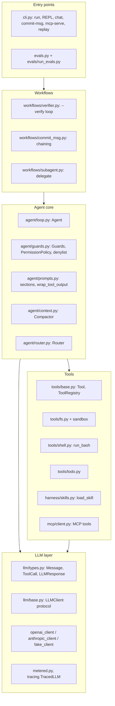

# minicode architecture

This document goes one level deeper than the README: what each component is responsible for, how
data flows through one task, and where the extension points are. File references are to
`src/minicode/`.

## 1. Layers

Dependencies only point downwards. `llm/` knows nothing about tools or agents, and `tools/` knows
nothing about the agent loop. That is what allows `FakeLLMClient` tests at every level, and lets the
MCP server reuse `ToolRegistry` without an agent.

## 2. One task, step by step

`minicode run "Fix the failing tests" --cwd repo --verify "pytest -q"`:

1. **Settings** (`config.py`): `.minicode/config.toml` < `.env` < environment. Keys are `SecretStr`.
2. **Wiring** (`cli.build_agent`): main and small clients, both wrapped in `TracedLLM`; the toolbelt
   (fs, `run_bash`, todo, `delegate`, `load_skill` if there are skills, plus MCP tools); the system
   prompt from a `PromptContext` (cwd, OS, date, git status, `AGENTS.md`, skill list);
   `PermissionPolicy(mode)`; `Compactor(small)`; `Router(small)`; and the listener (rich UI plus
   trace).
3. **Routing** (`Agent._choose_tools`): the small model returns `TaskRoute`. A `question` route gets
   `registry.subset(risk == "read")`.
4. **Loop** (`Agent._loop`):
   1. `Guards.check(steps, usage, cost, elapsed)` runs before every LLM call;
   2. `llm.complete(history, system, tools=schemas)` streams text through `listener.on_text`;
   3. no tool calls means `completed` (or `output_truncated`);
   4. otherwise an empty tool message is appended, then `_execute_all` runs.
5. **Acting** (`_execute_all`): consecutive `read` calls go to a thread pool, with results collected
   in call order. Every other call runs alone: `PermissionPolicy.decide` checks the denylist, then
   the mode and the prompt, then `ToolRegistry.execute`, which validates the arguments, calls the
   handler, catches errors and truncates the output. Results are wrapped in
   `<tool_output tool="…">`.
6. **Housekeeping**: `Compactor.maybe_compact` (clear old long results, then summarize old steps)
   and `listener.on_notice`.
7. **Verify** (`run_with_verification`): if the run `completed`, run the check. On failure, the
   output goes back as a new user turn, up to K checks.
8. **Trace**: `run_start`, then the `llm_call` and `tool_call` events, `verify`, and `run_end`, all
   written to `.minicode/traces/*.jsonl` after masking.

## 3. Key data types

| Type | File | Notes |
|---|---|---|
| `Message(role, content, tool_calls, tool_results)` | `llm/types.py` | Roles are `user`, `assistant` and `tool`; one `tool` message per assistant turn |
| `ToolCall(id, name, arguments)` / `ToolResult(call_id, content, is_error)` | `llm/types.py` | Unparseable JSON arguments are kept under `__invalid_json__` |
| `LLMResponse(text, tool_calls, stop_reason, usage)` | `llm/types.py` | `stop_reason` is one of `end_turn`, `tool_use`, `max_tokens` or `other` |
| `Tool(name, description, input_model, handler, risk, input_schema?)` | `tools/base.py` | `risk` is `read`, `write` or `exec`; it drives permissions and parallelism |
| `AgentResult(final_text, steps, usage, stop_reason, cost)` | `agent/loop.py` | Stop reasons: `completed`, `output_truncated`, `max_steps`, `token_budget`, `cost_budget`, `wall_time`, `interrupted` |

## 4. Provider adapters

Both adapters translate the neutral history into the provider's wire format and back
(`docs/sdk-notes.md` has the verified SDK details).

| | OpenAI Responses (`openai_client.py`) | Anthropic Messages (`anthropic_client.py`) |
|---|---|---|
| System prompt | `instructions` | `system` |
| Assistant tool calls | `function_call` items (`arguments` is a JSON string) | `tool_use` blocks (`input` is a dict) |
| Tool results | `function_call_output` items; errors are prefixed with `ERROR:` | `tool_result` blocks inside a **user** message, with `is_error` |
| State | `store=False`; the full history is resent | Stateless |
| Streaming | `responses.stream`, `response.output_text.delta` | `messages.stream`, `text_stream` |

## 5. Safety model

| Layer | Where | Applies in | Stops |
|---|---|---|---|
| Workspace sandbox | `tools/fs.resolve_in_workspace` | every mode | `..`, absolute paths outside the workspace, escaping symlinks (also re-checked on glob/grep results) |
| Command denylist | `agent/guards.dangerous_command_reason` | every mode, before asking | `rm -rf /`, `sudo`, `curl … \| sh`, `mkfs`, `dd of=/dev/…`, fork bomb, … |
| Permission prompt | `PermissionPolicy` | `ask`: write + exec; `accept-edits`: exec | anything the user declines |
| Untrusted-data marking | `prompts.wrap_tool_output` + safety section | always | makes injection less likely (not a guarantee) |
| Secret hygiene | `shell.scrubbed_env`, `tracing.mask_secrets`, MCP env whitelist | always | keys leaking to commands, traces and MCP servers |
| Read-only paths | router `question`, `delegate` workers, `mcp-serve` default | as configured | edits where none were asked for |

`tests/contract/test_m5_prompt_injection.py` scripts a model that obeys a malicious README and
checks each layer. The known gap: in `auto` mode, a command that is not on the denylist (such as
`cat ~/.ssh/id_rsa`) would run.

## 6. Context management

- **Every request** carries the system prompt, the whole history and the tool schemas.
- **Bounded inputs**:
  - `read_file` returns at most 500 lines;
  - the registry truncates output to 600 lines or 40k chars, keeping the head and the tail;
  - `AGENTS.md` is capped at 20k chars;
  - git status is capped at 2k chars.
- **Compaction**, once the estimated size passes `compact_at_tokens`:
  1. clear old tool results longer than 2k chars;
  2. if still too large, summarize everything before the last 6 steps with the small model,
     keeping the user's requests verbatim.

  The cut is always before an assistant message, so a tool call is never separated from its results.
- **Subagents** keep exploratory reads out of the main history entirely.

## 7. Extension points

| To add… | Implement | Register in |
|---|---|---|
| A provider | an `LLMClient` (`model` + `complete(...)`) | `llm/factory.create_client` |
| A tool | a pydantic input model, a handler that raises `ToolError` with advice, and a risk | `tools/toolbelt.build_registry` or `cli.build_agent` |
| A remote tool | nothing: add an MCP server to `.minicode/mcp.json` | loaded automatically, risk `exec` |
| Project knowledge | `AGENTS.md` or `.minicode/skills/<name>/SKILL.md` | discovered automatically |
| A UI or telemetry sink | an `AgentListener` (`on_text`, `on_tool_call`, `on_tool_result`, `on_notice`) | `FanoutListener` in `cli.build_agent` |
| An eval | `evals/tasks/<id>/{task.yaml, repo/, check.py}` | discovered by `load_tasks` |

## 8. Testing strategy

- **`tests/contract/`** uses only public APIs, with one marker per milestone (`m0`…`m8`). A learner
  can copy it into their own `minicode` package and run `pytest -m mN`.
- **`tests/unit/`** covers internals and CLI wiring. `typer.testing.CliRunner` runs with
  `create_client` monkeypatched to return a `FakeLLMClient`.
- **Real processes where it matters**: bash commands, a git repo in `tmp_path`, the MCP server as a
  subprocess, and the pytest runs that eval checks perform.
- **`tests/e2e/`** holds live tests. They are marked `live` and run only with `--run-live`.
- **Evals** (`evals/`) measure behaviour with real models. They are not run in CI.
